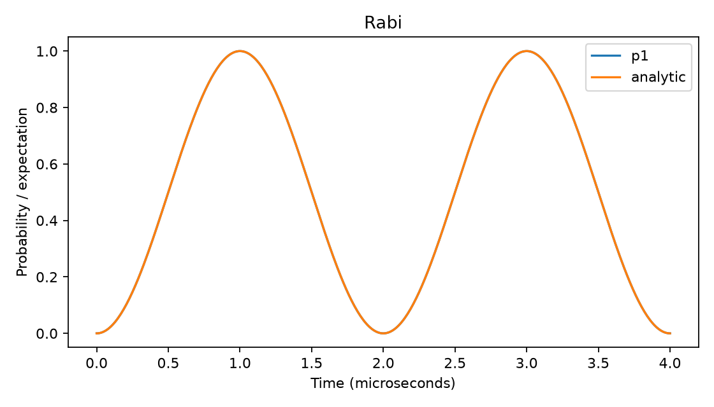

# ⚛️ Qubit Zero to Hero · English Edition

<p align="center">
  <a href="https://qutip.org/"></a>&nbsp;&nbsp;&nbsp;
  <a href="https://www.python.org/"></a>
</p>
<p align="center"><strong>One quantum framework. Ten runnable experiments. A path from first qubit to research.</strong></p>

Learn to simulate qubits with **QuTiP 5.3.1**, then build reproducible experiments in **open-system dynamics, pulse control, robustness, leakage, and small QAOA assignment problems**. Lessons, exercise guides, code, and project documentation are in English.

“Hero” means being able to define a model, implement it, validate it independently, and report its limits. It does not mean demonstrating quantum advantage or reproducing a paper merely by running the examples.

## 🧭 Why one framework?

QuTiP provides the state, operator, tensor-product, and differential-equation abstractions used throughout this project. NumPy, SciPy, and Matplotlib support arrays, classical optimization, and plotting. No second quantum SDK is needed to complete the course.

This edition is maintained as a separate repository. See [source provenance](docs/SOURCE_PROVENANCE.md) for the relationship to the original course and the preserved example outputs.

The [framework decision](docs/FRAMEWORK_DECISION.md) explains why this curriculum uses QuTiP rather than a circuit-first stack, and where separate Qiskit or Quantum Inspire projects become useful.

## 🚀 Start on Windows or Ubuntu

Use the full [Windows PowerShell guide](docs/WINDOWS.md) or [Ubuntu Bash guide](docs/UBUNTU.md). Both cover prerequisites, installation, exercises, tests, saved results, and troubleshooting. Begin with [Lesson 00](lessons/00_setup.md) if terminals or environments are new to you.

### Windows PowerShell

Install Python 3.13 and Git, then run:

```powershell
git clone https://github.com/croznnt/qubit-zero-to-hero-english.git
cd qubit-zero-to-hero-english
py -3.13 -m venv .venv
.\.venv\Scripts\python.exe -m pip install -e ".[dev]"
.\.venv\Scripts\python.exe -m qubit_course.cli basics --output runs/windows-first
.\.venv\Scripts\python.exe -m pytest -q
```

### Ubuntu Bash

On Ubuntu 24.04 LTS with Python 3.11 or newer:

```bash
sudo apt update
sudo apt install -y git python3 python3-venv python3-pip
git clone https://github.com/croznnt/qubit-zero-to-hero-english.git
cd qubit-zero-to-hero-english
python3 -m venv .venv
./.venv/bin/python -m pip install -e ".[dev]"
./.venv/bin/python -m qubit_course.cli basics --output runs/ubuntu-first
./.venv/bin/python -m pytest -q
```

Direct interpreter paths avoid activation ambiguity. To use the shorter `python` commands in later lessons, activate with `.\.venv\Scripts\Activate.ps1` on Windows or `source .venv/bin/activate` on Ubuntu. Recreate `.venv` separately on each operating system; do not copy it between machines.

CI passed on **Windows and Ubuntu 24.04**, each with Python **3.12 and 3.13**, for the published source revision. See the [verified run](https://github.com/croznnt/qubit-zero-to-hero-english/actions/runs/39176530736) and [validation report](docs/VALIDATION.md) for scope and evidence.

## 📖 Learning path

| Stage | Lesson | Working result |
| :--- | :--- | :--- |
| 00 | [Environment and first run](lessons/00_setup.md) | An isolated environment and saved run |
| Prep | [Python and math essentials](lessons/00b_python_math.md) | Functions, complex numbers, vectors, and matrix products |
| 01 | [Complex vectors and qubit states](lessons/01_states.md) | Amplitudes, normalization, and Bloch coordinates |
| 02 | [Gates and measurement](lessons/02_gates_measurement.md) | Rotations, probabilities, and finite-shot samples |
| 03 | [Hamiltonians and Rabi dynamics](lessons/03_dynamics.md) | Numerical evolution checked against an analytic limit |
| 04 | [Density matrices and noise](lessons/04_noise.md) | T1, pure dephasing, T2, and physicality checks |
| 05 | [Two qubits and entanglement](lessons/05_entanglement.md) | Tensor ordering, partial traces, and Bell correlations |
| 06 | [Build a research project](lessons/06_project.md) | Modules, metadata, tests, and artifact conventions |
| 07 | [Bounded pulse optimization](lessons/07_control.md) | A complete X-gate optimization problem |
| 08 | [Robustness, leakage, convergence](lessons/08_validation.md) | Held-out uncertainty and model-mismatch checks |
| 09 | [QAOA for a tiny UAV assignment](lessons/09_qaoa_assignment.md) | Six-qubit optimization checked by exhaustive enumeration |
| 10 | [Research capstone](lessons/10_capstone.md) | A scoped experiment with baselines and an evidence report |

Every lesson includes concepts, source references, commands, expected behavior, exercises, and a completion gate. See the [study plan](docs/STUDY_PLAN.md) for suggested pacing and prerequisites.

## 🧑‍💻 Learn by completing real exercises

The [guided exercise collection](exercises/README.md) adds **ten editable starters**, **ten separate reference solutions**, English task instructions, graduated hints, and an independent feedback CLI.

```console
python -m qubit_course.labs list
python -m qubit_course.labs check basics
python -m qubit_course.labs check basics --solution
python -m qubit_course.labs check all --solution
```

Untouched starters intentionally report `UNFINISHED` with exit code 1. Implement `solve(seed=42)` in the selected `starter.py`, using the documented return fields. Use `--file PATH` to check your own copy and `--report PATH` to save feedback without overwriting an existing file.

The checker executes the selected Python file in the current process. Run only trusted code. It provides learning feedback, not a secure grading service or proof of general scientific correctness. Read [GUIDED_LABS.md](docs/GUIDED_LABS.md) for workflow, contracts, and limits. These files require the repository source checkout.

## 🧪 Ten runnable experiments

```console
python -m qubit_course.cli all --seed 42 --output runs/full-seed42
```

Available names: `basics`, `gates`, `rabi`, `noise`, `entanglement`, `control`, `robustness`, `leakage`, `convergence`, `assignment`.

Each experiment saves `metrics.json`, `metadata.json`, `arrays.npz`, and `figure.png` under its own folder. Existing completed runs are protected against accidental overwrite: choose a fresh output directory. Optimizers may stop at a local solution or reach an iteration budget; inspect the saved success flag and message.

## 🔬 Connection to the research discussed

| Research direction | Implemented foundation | Boundary |
| :--- | :--- | :--- |
| Quantum dynamics and optimal control | Rabi evolution, Lindblad noise, bounded piecewise pulses | Teaching optimizer uses SciPy; no claim of implementing GRAPE or GOAT |
| Robust quantum control | Uncertainty ensemble and disjoint validation grid | No hardware calibration or feedback experiment |
| Weakly anharmonic systems | Three-level leakage example | Additional truncation levels remain a research extension |
| UAV search and rescue optimization | Small QAOA task-assignment model | No flight physics, perception, communications, or survivor simulation |
| QAOA libraries and training tools | Explicit energy, bit, and angle conventions | External adapters and cross-library equivalence are not implemented |
| MATLAB / Quantum Inspire | Mathematical definitions and exportable arrays | No MATLAB execution or cloud hardware submission in this course |

Read the [research bridge](docs/RESEARCH_BRIDGE.md) for concrete next projects and links to the two resource repositories from this conversation.

## 🗂️ Project structure

```text
lessons/                 Step-by-step English course
exercises/               Editable starters, reference solutions, and lab guides
docs/                    Decisions, conventions, research bridge, verification
src/qubit_course/        Reusable models, experiments, and CLI
tests/                   Independent analytic and physics checks
evidence/                Recorded verification summary and selected figures
requirements-lock.txt    Exact dependencies from the verified environment
.github/workflows/       Continuous integration
```

The lock file records a tested environment, not a universal cross-platform guarantee. For a source checkout on the tested Python version, install it with `python -m pip install -r requirements-lock.txt` and then `python -m pip install -e . --no-deps`.

## 📏 Scientific conventions

Time is in microseconds, angular frequency in radians per microsecond, and ℏ = 1. Basis states are explicitly defined as |0⟩ and |1⟩. State-transfer probability, squared unitary trace overlap, and average gate fidelity are different quantities. Read [CONVENTIONS.md](docs/CONVENTIONS.md) before interpreting plots or comparing tools.

Source guidance is collected in [SOURCES.md](docs/SOURCES.md). Local execution evidence and limitations are in [VALIDATION.md](docs/VALIDATION.md). This is an educational simulator project, not a hardware control system.

## 📊 Example output

The Rabi experiment compares numerical populations with an analytic reference. The overlapping curves below are generated by the included CLI, not an illustrative mockup.



## 🎓 Lecture slides

[S00: Your first qubit simulation](lectures/S00-orientation/README.md) includes 12 core slides and 2 appendix slides in English, with PowerPoint, PDF, copyable commands and detailed instructor notes. It covers native Windows and Ubuntu setup, the first experiment and readiness checks. Later lecture decks are planned separately.

## 🤝 Contribute

Follow [CONTRIBUTING.md](CONTRIBUTING.md). Add an independent check for a new physical model, document units and assumptions, and separate proposed extensions from measured results.

## 📄 License

Original course code and documentation are provided under the [MIT License](LICENSE). Dependencies and external references retain their own licenses.
