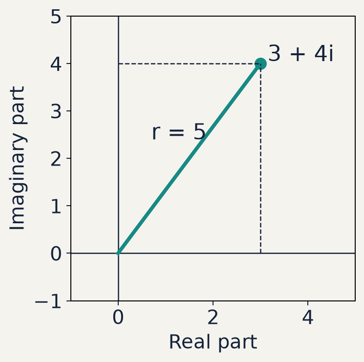
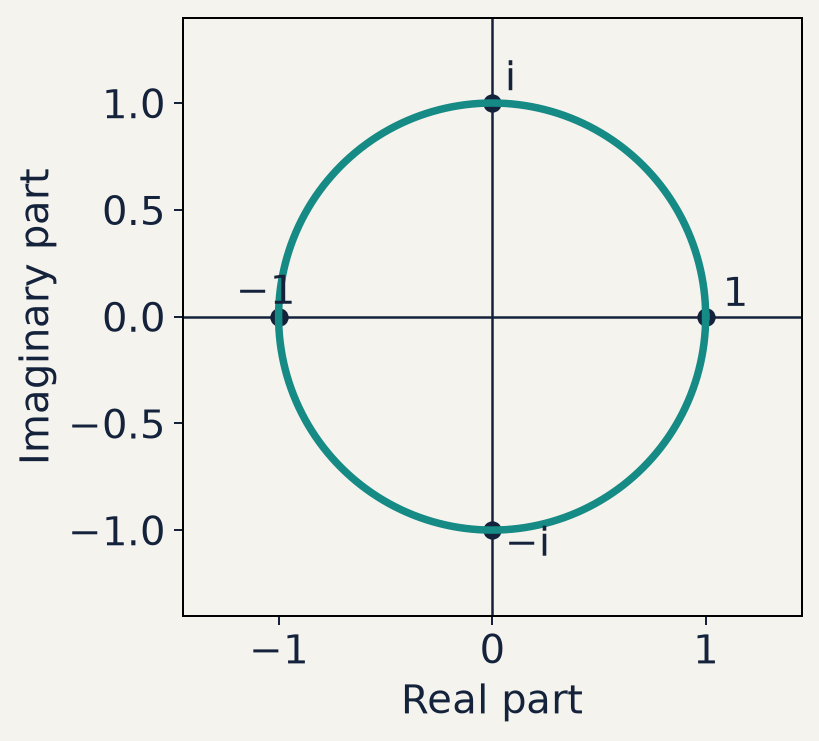
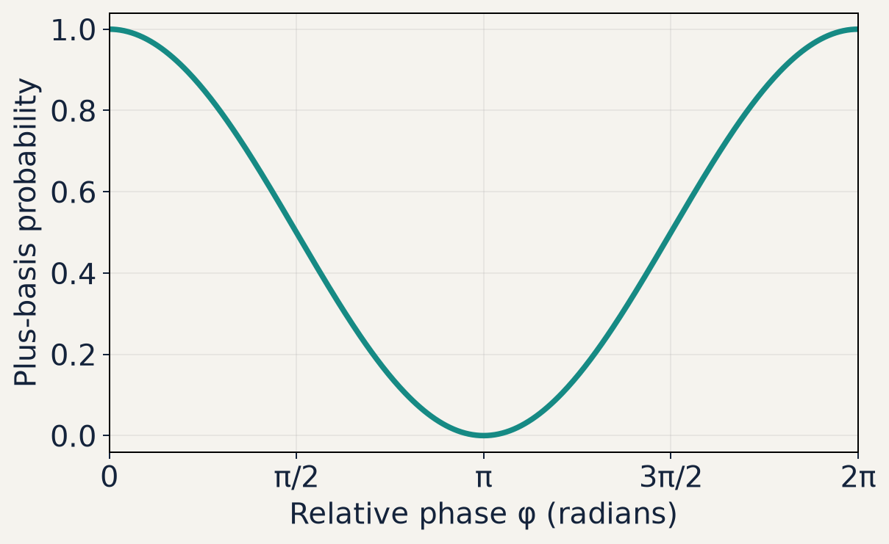

# S01: Complex numbers and phase

20 core slides and 4 appendix slides. Plain-text `e^(iφ)` means an exponential power.

## 1. Complex numbers and phase

* Cartesian form, magnitude and phase
* Step-by-step calculations and Python checks

## 2. The imaginary unit

```text
i² = −1
```

* A real square cannot equal −1. Complex numbers extend the real numbers.
* In mathematics we write i. In Python we write 1j.
* Example: 3 + 4i in mathematics is 3 + 4j in Python.

## 3. Cartesian form and arithmetic

```text
z = a + ib
```

* a = Re(z) and b = Im(z), with a and b real.
* (a + ib) + (c + id) = (a + c) + i(b + d)
* (a + ib)(c + id) = (ac − bd) + i(ad + bc)

## 4. The complex plane



* 3 + 4i is the point (3, 4).
* Horizontal axis: real part
* Vertical axis: imaginary part

## 5. Complex conjugation

```text
z* = a − ib
```

* Conjugation flips the sign of the imaginary coordinate.
* If z = 3 + 4i, then z* = 3 − 4i.
* Useful check: (z*)* = z.

## 6. Squared magnitude, line by line

```text
z* × z = (a − ib)(a + ib)
       = a² + iab − iab − i²b²
       = a² + b² = |z|²
```

* The cross terms cancel. Since i² = −1, the last term is +b².
* The result is real and nonnegative.

## 7. Amplitude and probability

```text
p₀ = |α|²       p₁ = |β|²
|α|² + |β|² = 1
```

* A normalized qubit state has amplitudes α and β for outcomes 0 and 1.
* An arbitrary complex number need not be a valid normalized amplitude.
* Example: |3 + 4i|² = 25, so this alone cannot be a probability.

## 8. A complex square is different

```text
z = (1 + i)/2
z² = i/2
|z|² = (1² + 1²)/4 = 1/2
```

* z² multiplies z by itself. |z|² multiplies z* by z.
* The probability contribution is 1/2, a real number.

## 9. Polar coordinates and radians

```text
z = r(cos φ + i sin φ)
r = |z|       φ = atan2(b, a)
```

* r is the distance from the origin. φ is the phase angle.
* π radians = 180°. A full turn is 2π radians.
* The phase of zero is undefined. atan2 preserves the quadrant.

## 10. Unit magnitude and phase



* r = 1 on the unit circle.
* φ = 0 gives 1.
* φ = π/2 gives i.
* φ = π gives −1.

## 11. Euler’s identity and polar form

```text
e^(iφ) = cos φ + i sin φ
z = r e^(iφ)
|e^(iφ)|² = cos²φ + sin²φ = 1
```

* The exponential is a compact way to write the same complex number.
* At φ = π: e^(iπ) = −1, hence e^(iπ) + 1 = 0.

## 12. Multiplication adds phase

```text
z₁z₂ = r₁r₂ e^(i(φ₁ + φ₂))
(r e^(iφ))* = r e^(−iφ)
```

* Multiplication multiplies magnitudes and adds phases.
* Conjugation reverses phase while preserving magnitude.
* Example: (2i)(−i) = 2, with phase π/2 − π/2 = 0.

## 13. Example 1 · Cartesian to polar

```text
z = 3 + 4i
r = √(3² + 4²) = 5
φ = atan2(4, 3) ≈ 0.927295 rad
z ≈ 5 e^(i × 0.927295)
```

* The angle is about 53.130°. The exponential uses radians.

## 14. Example 2 · A probability contribution

```text
α = (1 + i)/2
α* = (1 − i)/2
|α|² = α*α = (1 + 1)/4 = 1/2
|α| = 1/√2
```

* A second amplitude with squared magnitude 1/2 completes normalization.

## 15. Example 3 · Phase rotation

```text
α = (1 + i)/2       φ = π/2
α′ = e^(iπ/2) α = i(1 + i)/2
α′ = (−1 + i)/2
|α′|² = 1/2 = |α|²
```

* Multiplying an amplitude by a unit phase preserves its squared magnitude.

## 16. Phase can affect an interference result



* A₊ = (1 + e^(iφ))/2
* p₊ = |A₊|² = (1 + cos φ)/2
* At φ = 0: p₊ = 1
* At φ = π: p₊ = 0

## 17. Code walkthrough 1 · NumPy arithmetic

```text
import numpy as np
z = 3 + 4j
print(z.real, z.imag)           # 3.0 4.0
print(np.conjugate(z))          # (3-4j)
print(abs(z), abs(z)**2)        # 5.0 25.0
print(np.angle(z))              # 0.927295...
assert np.isclose(abs(z)**2, 25.0)
```

* Python uses ** for powers. NumPy angles use radians.

## 18. Code walkthrough 2 · QuTiP correspondence

```text
import numpy as np
import qutip as qt
a = (1 + 1j) / 2
b = 1 / np.sqrt(2)
psi = a*qt.basis(2, 0) + b*qt.basis(2, 1)
p0 = qt.expect(qt.basis(2, 0).proj(), psi)
assert np.isclose(p0, abs(a)**2)
```

* For this normalized state, both calculations give p₀ = 1/2.

## 19. Practice · Calculate before running code

* 1. For z = −3 + 4i, find z*, |z|² and its quadrant.
* 2. For α = (1 − i)/2, compare α² with |α|².
* 3. For z = 2 e^(iπ/3), find its Cartesian coordinates.
* 4. Complete starter.py and compare with solution.py.

## 20. Exit check and the next lesson

* Why does conjugation make |z|² real and nonnegative?
* Why does multiplying by e^(iφ) preserve a magnitude?
* How can relative phase change an interference probability?
* Next: S02 develops vectors, inner products and matrices.

## 21. Appendix · Worked practice answers

```text
(−3 + 4i)* = −3 − 4i       |−3 + 4i|² = 25
((1 − i)/2)² = −i/2       |(1 − i)/2|² = 1/2
2 e^(iπ/3) = 2(1/2 + i√3/2) = 1 + i√3
```

* Quadrant II gives atan2(4, −3) ≈ 2.214297 rad.
* The phase of a nonzero number is equivalent modulo 2π.

## 22. Appendix · Global and relative phase

```text
ψ = (α, β)
Global phase: e^(iχ)ψ = (e^(iχ)α, e^(iχ)β)
Relative phase change: (α, e^(iφ)β)
```

* A common phase cancels from every measurement probability.
* A relative phase can change probabilities in another measurement basis.

## 23. Appendix · Why Euler’s formula works

```text
e^(iφ) = 1 + iφ + (iφ)²/2! + (iφ)³/3! + ⋯
Real terms: 1 − φ²/2! + φ⁴/4! − ⋯ = cos φ
Imaginary terms: i(φ − φ³/3! + ⋯) = i sin φ
```

* Powers of i repeat: 1, i, −1, −i, then 1 again.

## 24. Appendix · Running the supplied files

```text
Windows · PowerShell (from the repository root)
.\.venv\Scripts\python.exe lectures/S01-complex-numbers/examples.py
.\.venv\Scripts\python.exe lectures/S01-complex-numbers/starter.py

Ubuntu · Bash (from the repository root)
./.venv/bin/python lectures/S01-complex-numbers/examples.py
./.venv/bin/python lectures/S01-complex-numbers/starter.py
```

* Use solution.py in place of starter.py to check the reference.