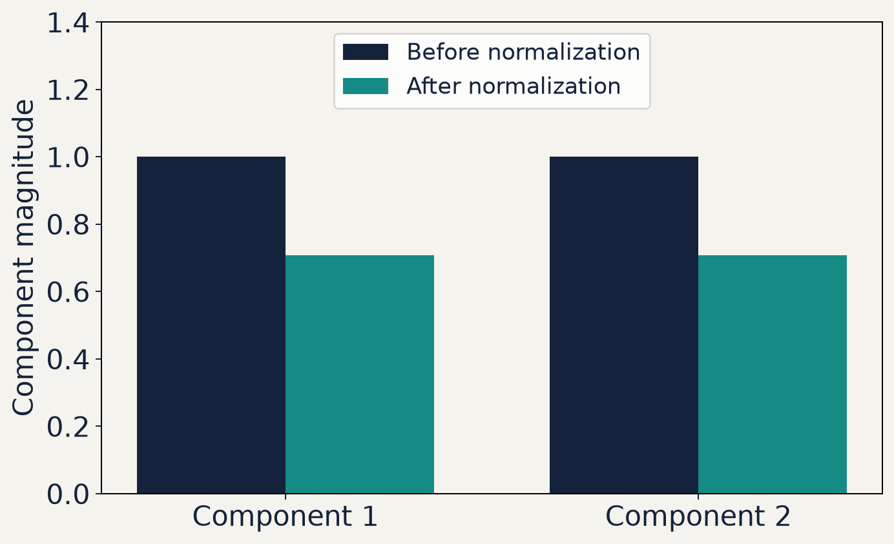
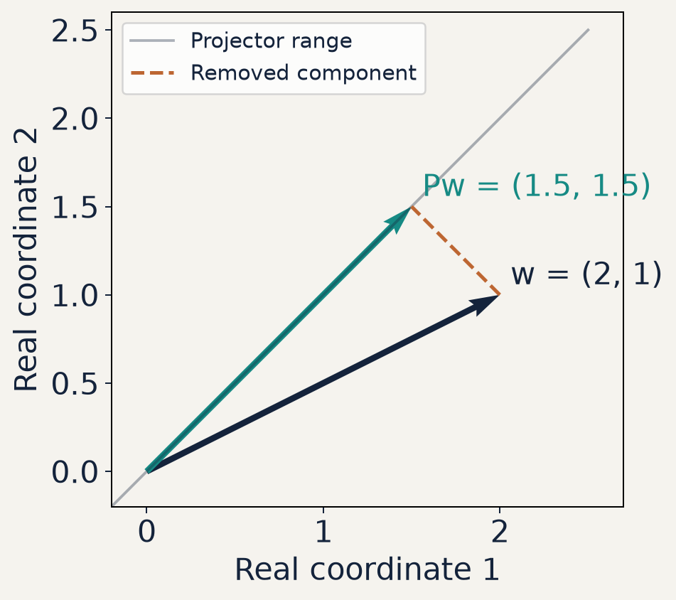
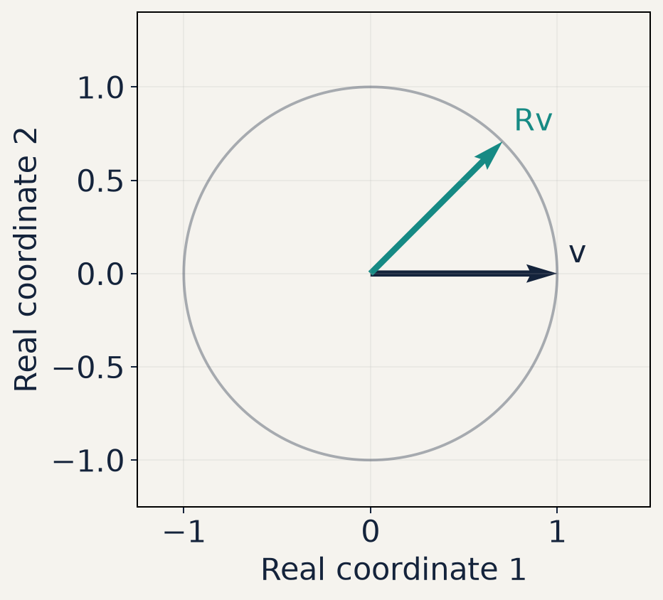
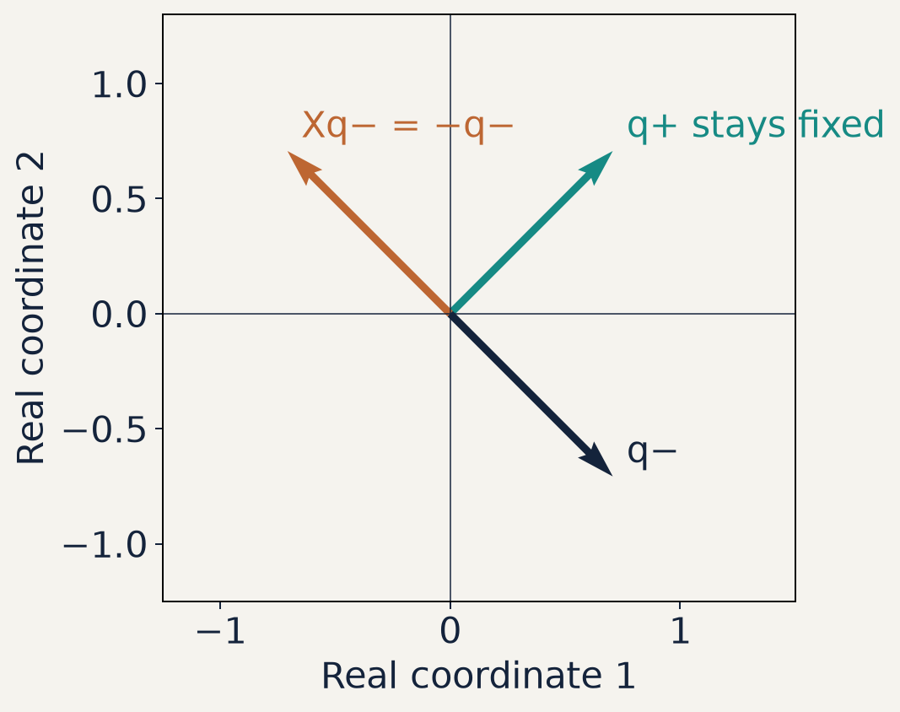
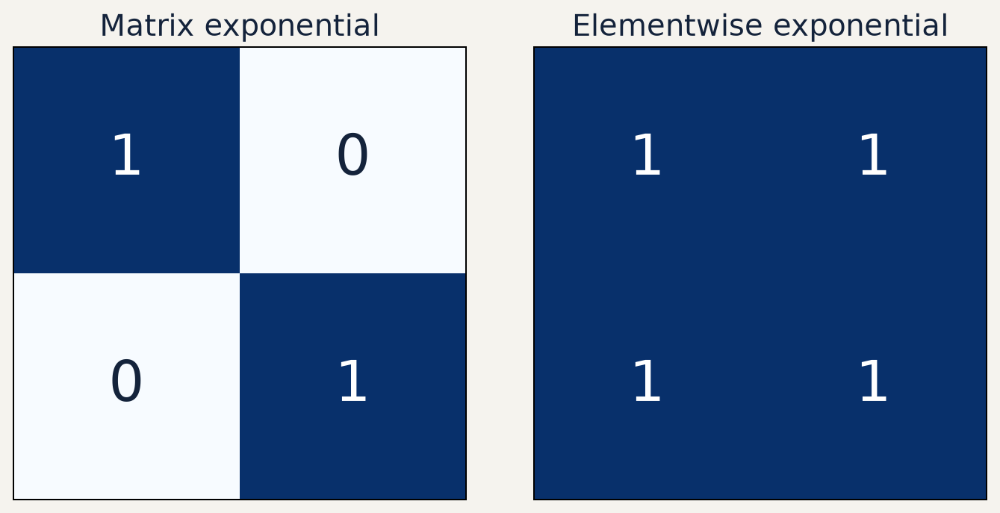
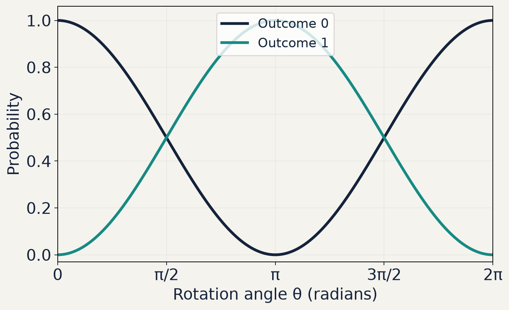

# S02: Vectors, matrices and operators

28 original core slides, 6 visual explanations and 4 appendix slides. Mathematical expressions use LaTeX.

## 1. Vectors, matrices and operators

* S02 · Mathematical foundations
* LaTeX derivations with NumPy and QuTiP checks

## 2. Column vectors and components

$$
\begin{gathered}
v=\begin{pmatrix}v_1\\v_2\end{pmatrix}\in\mathbb C^{2\times1},\qquad v_1,v_2\in\mathbb C
\end{gathered}
$$

* A column vector stores ordered complex components.
* Its shape records two rows and one column.
* A ket is a quantum-state column vector with a specified basis.

## 3. Matrix shapes and multiplication

$$
\begin{gathered}
A\in\mathbb C^{m\times n},\quad v\in\mathbb C^{n\times1},\quad Av\in\mathbb C^{m\times1}\\[12pt](Av)_i=\sum_{j=1}^{n}A_{ij}v_j
\end{gathered}
$$

* The shared dimension n must agree.
* Each output component is a row of A multiplied by the column v.

## 4. Example 1 · Normalizing a vector

$$
\begin{gathered}
v=\begin{pmatrix}1\\ i\end{pmatrix},\qquad \|v\|=\sqrt{|1|^2+|i|^2}=\sqrt2\\[12pt]u=\frac{v}{\|v\|}=\frac1{\sqrt2}\begin{pmatrix}1\\ i\end{pmatrix},\qquad\|u\|=1
\end{gathered}
$$

* Normalization divides every component by the same positive norm.
* The zero vector cannot be normalized.

## 5. Normalization preserves component ratios



* The example vector has component magnitudes 1 and 1.
* Dividing by √2 scales both magnitudes equally.
* The sum of squared magnitudes changes from 2 to 1.

## 6. Transpose, conjugate and adjoint

$$
\begin{gathered}
v=\begin{pmatrix}1\\i\end{pmatrix},\quad v^{\mathsf T}=\begin{pmatrix}1&i\end{pmatrix},\quad v^\dagger=\begin{pmatrix}1&-i\end{pmatrix}\\[12pt]A^\dagger=(A^*)^{\mathsf T},\qquad (AB)^\dagger=B^\dagger A^\dagger
\end{gathered}
$$

* Transpose exchanges rows and columns.
* Adjoint conjugates every entry and then transposes.

## 7. The complex inner product

$$
\begin{gathered}
\langle u,v\rangle=u^\dagger v=\sum_{j=1}^{n}u_j^*v_j\\[12pt]\langle v,u\rangle=\langle u,v\rangle^*
\end{gathered}
$$

* The first vector is conjugated in this convention.
* The inner product is a complex scalar.
* Orthogonal vectors have inner product zero.

## 8. Norm and overlap bound

$$
\begin{gathered}
\|v\|^2=\langle v,v\rangle=\sum_j|v_j|^2\geq0\\[12pt]|\langle u,v\rangle|\leq\|u\|\,\|v\|
\end{gathered}
$$

* The Euclidean norm is the nonnegative square root.
* For normalized vectors, the squared overlap lies between zero and one.

## 9. Example 2 · A complex orthogonality check

$$
\begin{gathered}
u=\frac1{\sqrt2}\begin{pmatrix}1\\ i\end{pmatrix},\quad v=\frac1{\sqrt2}\begin{pmatrix}i\\1\end{pmatrix}\\[12pt]u^\dagger v=\frac12\bigl(1\cdot i+(-i)\cdot1\bigr)=0
\end{gathered}
$$

* Both vectors have norm one, and their inner product vanishes.
* Without conjugation, the same component sum would give i.

## 10. Outer products are operators

$$
\begin{gathered}
u\in\mathbb C^{n\times1},\quad v^\dagger\in\mathbb C^{1\times n}\\[12pt]uv^\dagger\in\mathbb C^{n\times n},\qquad (uv^\dagger)_{ij}=u_i v_j^*
\end{gathered}
$$

* An inner product gives a scalar. An outer product gives a matrix.
* A normalized vector defines a projector onto its direction.

## 11. Example 3 · A rank-one projector

$$
\begin{gathered}
P=uu^\dagger=\frac12\begin{pmatrix}1&-i\\i&1\end{pmatrix}\\[12pt]P^\dagger=P,\quad P^2=P,\quad Pu=u,\quad Pv=0
\end{gathered}
$$

* The projector keeps u and removes its orthogonal direction v.
* Its trace is one, matching its one-dimensional range.

## 12. Projection in a real plane



* Additional real example: project onto the line y = x.
* The vector (2, 1) projects to (1.5, 1.5).
* The dashed residual is perpendicular to that line.

## 13. Hermitian operators

$$
\begin{gathered}
A^\dagger=A\\[12pt]Z=\begin{pmatrix}1&0\\0&-1\end{pmatrix},\qquad Y=\begin{pmatrix}0&-i\\i&0\end{pmatrix}
\end{gathered}
$$

* A Hermitian matrix equals its own adjoint.
* Its eigenvalues are real, and it has an orthonormal eigenbasis.

## 14. Why Hermitian expectations are real

$$
\begin{gathered}
a=v^\dagger Av\\[10pt]a^*=(v^\dagger Av)^\dagger=v^\dagger A^\dagger v=v^\dagger Av=a
\end{gathered}
$$

* A scalar equal to its own conjugate is real.
* For a normalized state, this is the expectation of the observable A.

## 15. Unitary operators preserve inner products

$$
\begin{gathered}
U^\dagger U=I,\qquad U^{-1}=U^\dagger\\[12pt]\langle Uu,Uv\rangle=u^\dagger U^\dagger Uv=u^\dagger v
\end{gathered}
$$

* A square unitary matrix preserves lengths and overlaps.
* Its columns form an orthonormal basis.

## 16. A real rotation is a unitary example



* The real rotation turns (1, 0) by π/4.
* Both endpoints lie on the unit circle.
* A real orthogonal rotation is a special case of a unitary matrix.

## 17. Hermitian and unitary are different tests

$$
\begin{gathered}
Z^\dagger=Z,\quad Z^\dagger Z=I\\[10pt](2Z)^\dagger=2Z,\quad (2Z)^\dagger(2Z)=4I\\[10pt]U=\operatorname{diag}(e^{-i\theta},e^{i\theta}),\quad U^\dagger U=I
\end{gathered}
$$

* Z passes both tests. 2Z is Hermitian but fails unitarity.
* The diagonal U is unitary for real θ and generally is not Hermitian.

## 18. Eigenvalues and eigenvectors

$$
\begin{gathered}
Av=\lambda v,\qquad v\neq0\\[12pt](A-\lambda I)v=0,\qquad \det(A-\lambda I)=0
\end{gathered}
$$

* An eigenvector keeps its direction under the linear map.
* Its eigenvalue gives the complex scale factor.

## 19. Hermitian eigensolvers and degeneracy

$$
\begin{gathered}
AQ=Q\Lambda,\qquad Q^\dagger Q=I,\qquad \Lambda=\operatorname{diag}(\lambda_1,\ldots,\lambda_n)
\end{gathered}
$$

* Columns of Q are orthonormal eigenvectors.
* Use numpy.linalg.eigh for a Hermitian matrix.
* Repeated eigenvalues define a subspace with many valid bases.

## 20. Spectral decomposition

$$
\begin{gathered}
A=Q\Lambda Q^\dagger=\sum_{k=1}^{n}\lambda_k\,|q_k\rangle\langle q_k|\\[12pt]I=\sum_{k=1}^{n}|q_k\rangle\langle q_k|
\end{gathered}
$$

* This form applies here to a finite Hermitian matrix.
* Each eigenprojector selects one orthonormal direction.

## 21. Example 4 · The spectrum of Pauli X

$$
\begin{gathered}
X=\begin{pmatrix}0&1\\1&0\end{pmatrix},\quad |+\rangle=\frac1{\sqrt2}\begin{pmatrix}1\\1\end{pmatrix},\quad |-\rangle=\frac1{\sqrt2}\begin{pmatrix}1\\-1\end{pmatrix}\\[12pt]X|+\rangle=|+\rangle,\quad X|-\rangle=-|-\rangle,\quad X=P_+-P_-
\end{gathered}
$$

* The eigenvalues are +1 and −1.
* The two eigenprojectors sum to the identity.

## 22. Eigenvectors of X in a real plane



* X exchanges the two real coordinates.
* The plus direction stays fixed: eigenvalue +1.
* The minus direction reverses: eigenvalue −1.

## 23. Functions of a Hermitian matrix

$$
\begin{gathered}
A=Q\Lambda Q^\dagger\quad\Longrightarrow\quad f(A)=Qf(\Lambda)Q^\dagger\\[12pt]f(\Lambda)=\operatorname{diag}\bigl(f(\lambda_1),\ldots,f(\lambda_n)\bigr)
\end{gathered}
$$

* For polynomials and the exponential, apply f to the eigenvalues.
* Elementwise application to the entries of A generally gives a different matrix.

## 24. The matrix exponential series

$$
\begin{gathered}
e^A=\sum_{k=0}^{\infty}\frac{A^k}{k!}=I+A+\frac{A^2}{2!}+\frac{A^3}{3!}+\cdots
\end{gathered}
$$

* The zeroth matrix power is I. Each higher power uses matrix multiplication.
* The series converges for every finite square matrix.
* Use scipy.linalg.expm for numerical matrix exponentials.

## 25. Two exponentials of the zero matrix



* Both panels start from the same 2 × 2 zero matrix.
* Matrix exponentiation gives the identity.
* Elementwise exponentiation gives a matrix of ones.

## 26. Pauli powers separate even and odd terms

$$
\begin{gathered}
X^2=I,\qquad X^{2k}=I,\qquad X^{2k+1}=X\\[12pt]e^{-iaX}=\left[\sum_{k=0}^\infty\frac{(-1)^ka^{2k}}{(2k)!}\right]I-i\left[\sum_{k=0}^\infty\frac{(-1)^ka^{2k+1}}{(2k+1)!}\right]X
\end{gathered}
$$

* Even powers contribute an identity term. Odd powers contribute an X term.
* Cosine and sine are the two scalar series.

## 27. A closed form for an X rotation

$$
\begin{gathered}
R_x(\theta)=e^{-i\theta X/2}=\cos\!\left(\frac\theta2\right)I-i\sin\!\left(\frac\theta2\right)X\\[12pt]R_x(\pi)|0\rangle=-i|1\rangle,\qquad R_x(0)=I
\end{gathered}
$$

* The angle θ is real and measured in radians.
* At θ = π, the final state differs from |1⟩ only by a global phase.

## 28. X rotation changes measurement probabilities



* The initial state is basis zero.
* Both probabilities add to one at every angle.
* At θ = π, outcome one has probability one.

## 29. Time evolution and the units of the exponent

$$
\begin{gathered}
U(t)=e^{-iHt/\hbar},\qquad H^\dagger=H,\qquad \hbar=1\\[12pt]H=\frac{\Omega}{2}X\quad\Longrightarrow\quad U(t)=R_x(\Omega t)
\end{gathered}
$$

* This expression assumes a time-independent Hamiltonian.
* The course uses time in μs and H/ℏ in rad/μs, so Ωt is dimensionless.

## 30. Matrix order matters

$$
\begin{gathered}
XZ=-ZX,\qquad [X,Z]=XZ-ZX=-2iY\\[12pt]e^{A+B}=e^Ae^B\quad\text{is guaranteed when }AB=BA
\end{gathered}
$$

* Arbitrary matrices need not obey the scalar exponential product rule.
* Check commutation before splitting an exponential.

## 31. Code walkthrough 1 · NumPy and SciPy

```python
import numpy as np
from scipy.linalg import expm
X = np.array([[0, 1], [1, 0]], dtype=complex)
values, Q = np.linalg.eigh(X)
theta = 0.7
U = expm(-1j * theta * X / 2)
U_spec = Q @ np.diag(np.exp(-1j*theta*values/2)) @ Q.conj().T
assert np.allclose(U, U_spec)
```

* Use @ for matrix products and .conj().T for the adjoint.

## 32. Code walkthrough 2 · QuTiP

```python
import qutip as qt
Xq = qt.sigmax()
Uq = (-1j * theta * Xq / 2).expm()
zero = qt.basis(2, 0)
final = Uq * zero
p1 = qt.expect(qt.basis(2, 1).proj(), final)
assert np.allclose(Uq.full(), U)
assert np.isclose(p1, np.sin(theta/2)**2)
```

* This continues slide 31, with NumPy, θ and U already defined.

## 33. Independent numerical checks

$$
\begin{gathered}
\epsilon_U=\|U^\dagger U-I\|_{\mathrm F},\qquad\epsilon_{\rm ref}=\|U-U_{\rm analytic}\|_{\mathrm F}\\[12pt]r_k=\|Aq_k-\lambda_kq_k\|_2
\end{gathered}
$$

* Check structure, a hand-derived reference and an eigenpair residual.
* Unitarity alone cannot prove that U implements the intended rotation.

## 34. Practice and exit checkpoint

* 1. Compute the adjoint and normalize the vector from Example 1.
* 2. Build its projector and test its action on an orthogonal vector.
* 3. Derive the exponential of an imaginary scalar times Pauli Z.
* 4. Explain why unitary output alone cannot validate a rotation angle.

## 35. Appendix · Notation and dimensions

$$
\begin{gathered}
|v\rangle:\ n\times1,\qquad \langle v|=|v\rangle^\dagger:\ 1\times n\\[12pt]\langle u|v\rangle:\ 1\times1,\qquad |u\rangle\langle v|:\ n\times n
\end{gathered}
$$

* T means transpose. A star means entrywise conjugation here.
* A dagger means conjugate transpose. I is the identity operator.

## 36. Proof of eigenvector orthogonality

$$
\begin{gathered}
Aq_j=\lambda_jq_j,\quad Aq_k=\lambda_kq_k,\quad A^\dagger=A\\[12pt]\lambda_k\,q_j^\dagger q_k=q_j^\dagger A q_k=\lambda_j\,q_j^\dagger q_k\\[12pt](\lambda_k-\lambda_j)\,q_j^\dagger q_k=0
\end{gathered}
$$

* If the real eigenvalues differ, the inner product must be zero.
* For a repeated eigenvalue, choose an orthonormal basis within its eigenspace.

## 37. Appendix · Practice answers

$$
\begin{gathered}
u=\frac1{\sqrt2}\begin{pmatrix}1\\i\end{pmatrix},\qquad P=\frac12\begin{pmatrix}1&-i\\i&1\end{pmatrix}\\[12pt]e^{-iaZ}=\begin{pmatrix}e^{-ia}&0\\0&e^{ia}\end{pmatrix}=\cos(a)I-i\sin(a)Z
\end{gathered}
$$

* The zero vector has no normalized version.
* Projector checks: Hermiticity, idempotence and action on its range.

## 38. Running on Windows and Ubuntu

```python
Windows PowerShell, from the repository root
.\.venv\Scripts\python.exe lectures/S02-linear-algebra/examples.py
.\.venv\Scripts\python.exe lectures/S02-linear-algebra/starter.py

Ubuntu Bash, from the repository root
./.venv/bin/python lectures/S02-linear-algebra/examples.py
./.venv/bin/python lectures/S02-linear-algebra/starter.py
```

* Run solution.py separately to check the reference implementation.